<picture>
  <source media="(prefers-color-scheme: dark)" srcset="./assets/header-dark.svg">
  
</picture>

  
  
  

### 👋 Hakkımda

17 yaşında, Türkiye'den bir geliştiriciyim. Günlük olarak CachyOS + Hyprland kullanıyorum, o yüzden yazdığım
şeylerin çoğu Linux'ta ve terminalde çalışıyor. Son dönemde neredeyse her şeyi **Rust** ile yazıyorum:
gerçek zamanlı ses işleme, arka planda 7/24 çalışıp haber veren izleme servisleri ve bunlara `ratatui` ile TUI'ler.
Web tarafında **Next.js + TypeScript**, eskiden de bolca **Java** (Minecraft plugin'leri).

- 🔭 Şu an: **MicForge**'u geliştiriyorum, gözcü servislerini VDS'te canlıya alıyorum
- 💬 Bir projemle ilgili fikrin ya da sorun mu var? İlgili repoda issue açman yeterli

### 🛠️ Öne çıkan projeler

<table>
  <tr>
    <td width="33%" valign="top">
      
      <h4><a href="https://github.com/Shidori5417/micforge">🎙️ MicForge</a></h4>
      Terminalde gerçek zamanlı mikrofon işleme stüdyosu: gürültü bastırma, 16 bantlı EQ, compressor, limiter, efektler. Çıktısı Discord/OBS'te sanal mikrofon olarak görünür, gecikme ~5–7 ms.
        
      
      
      
    </td>
    <td width="33%" valign="top">
      
      <h4><a href="https://github.com/Shidori5417/DomainSniper">🌐 DomainGözcü</a></h4>
      7/24 çalışan tek binary'lik domain izleme servisi. DNS → RDAP → WHOIS ile durumu tespit eder, değişince Discord ve Telegram'a haber verir. Geçici hatalar durumu bozmaz.
        
      
      
      
    </td>
    <td width="33%" valign="top">
      
      <h4><a href="https://github.com/Shidori5417/VanityGozcu">🔗 VanityGözcü</a></h4>
      Discord vanity URL'lerini izleyip boşalınca webhook ve Telegram ile haber veren araç. systemd altında daemon olarak çalışır, istediğin an TUI ile bağlanırsın.
        
      
      
      
    </td>
  </tr>
</table>

Bunların dışında private olarak geliştirdiğim projeler de var: portfolyo sitem (Next.js), Minecraft plugin paketi (Java), bir Discord botu (TypeScript) ve Flutter + NestJS ile konum tabanlı bir sosyal ağ denemesi.

### 🧰 Kullandıklarım

  

### 📊 İstatistikler

  <picture>
    <source media="(prefers-color-scheme: dark)" srcset="./assets/overview-dark.svg">
    
  </picture>
  <picture>
    <source media="(prefers-color-scheme: dark)" srcset="./assets/languages-dark.svg">
    
  </picture>

<picture>
  <source media="(prefers-color-scheme: dark)" srcset="https://raw.githubusercontent.com/Shidori5417/Shidori5417/output/snake-dark.svg">
  
</picture>

Kartlar bu repodaki <a href="./scripts/build_cards.py"><code>scripts/build_cards.py</code></a> ile her gün yeniden üretilir; private repoların yalnızca toplamları kullanılır, adları hiçbir yerde görünmez.
