# Mehmet Karaca

**17 y/o dev from Turkey. I build Rust tools for Linux and the terminal: audio, networking, TUIs.**

17 yaşında, Türkiye'den bir geliştiriciyim. Linux ve terminal için Rust araçları yazıyorum.

[Portfolio](https://mehmetkaraca.vercel.app) · [Email](mailto:karacamemo1@gmail.com)

## Featured

<table>
  <tr>
    <td width="50%" valign="top">
      
       <b><a href="https://github.com/Shidori5417/vuln-stack">vuln-stack</a></b> 
      Finds known CVE/GHSA vulnerabilities in your exact dependency versions from lock files (CLI + web app, 11 ecosystems). 
      TypeScript · Next.js · OSV.dev
    </td>
    <td width="50%" valign="top">
      
       <b><a href="https://github.com/Shidori5417/nobetci">nobetci</a></b> 
      Agentless multi-server Linux monitoring TUI over SSH. 
      Rust · ratatui · SSH
    </td>
  </tr>
  <tr>
    <td width="50%" valign="top">
      
       <b><a href="https://github.com/Shidori5417/micforge">micforge</a></b> 
      Real-time microphone processing in the terminal: noise suppression, 16-band EQ, compressor, virtual mic output. 
      Rust · PipeWire · ratatui
    </td>
    <td width="50%" valign="top">
      
       <b><a href="https://github.com/Shidori5417/pakiz">pakiz</a></b> 
      Wireshark-like packet analyzer for the terminal, without libpcap. 
      Rust · AF_PACKET · ratatui
    </td>
  </tr>
</table>

## More

- [helios-agent](https://github.com/Shidori5417/helios-agent): provider-neutral terminal coding agent in Rust (permission-checked tools, ratatui TUI, MCP/LSP)
- [DomainSniper](https://github.com/Shidori5417/DomainSniper) (DomainGözcü): 24/7 domain status monitor (DNS/RDAP/WHOIS) with Discord/Telegram alerts, in Rust
- [micctl](https://github.com/Shidori5417/micctl): PipeWire microphone DSP, soundboard and FX, CLI/TUI in Rust
- [Context-Switcher](https://github.com/Shidori5417/Context-Switcher): switch work modes with one command (processes, window layout, browser, audio), Python CLI/TUI
- [ExifGhost](https://github.com/Shidori5417/ExifGhost): desktop app that strips metadata from photos, audio and video locally, Python

## Now

- Building micforge: real-time mic processing on PipeWire
- Polishing nobetci and vuln-stack

## Stack

Rust · TypeScript/Next.js · Python · Java · Linux (Arch/Hyprland)

GitHub stats

  <picture>
    <source media="(prefers-color-scheme: dark)" srcset="./assets/overview-dark.svg">
    
  </picture>
  <picture>
    <source media="(prefers-color-scheme: dark)" srcset="./assets/languages-dark.svg">
    
  </picture>

Cards are regenerated daily by <a href="./scripts/build_cards.py"><code>scripts/build_cards.py</code></a>; only totals of private repos are counted, names are never shown.

