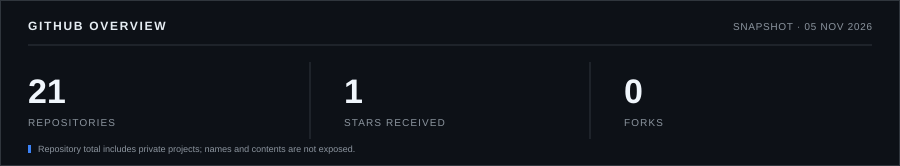
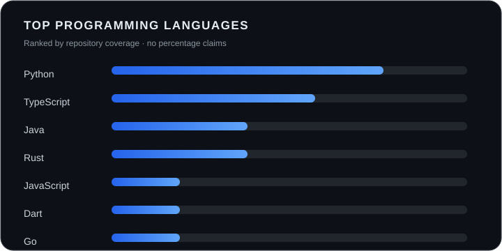

<!-- Header -->

## GitHub Statistics

## Language Breakdown

## About

I'm a software development student from Türkiye, focused on learning, building, and improving every day. I enjoy full-stack development, Linux, and open-source software.

## Programming Languages

